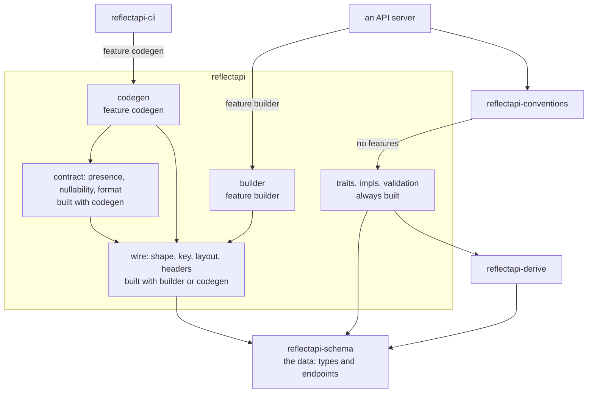

# Architecture

## Overview

ReflectAPI has three layers:

1. Rust types and handler functions define the API surface.
2. Reflection builds a `Schema`, which is the interchange format between the server side and code generators.
3. Codegen backends transform that schema into language-specific clients or an OpenAPI document.

The workspace is split accordingly:

- `reflectapi-schema`: raw schema types and raw-schema transforms
- `reflectapi-derive`: `#[derive(Input, Output)]` macros
- `reflectapi`: reflection traits, builder, runtime integrations, codegen backends, and the private compiler schema module
- `reflectapi-conventions`: opinionated API types and lints against the API design standard
- `reflectapi-cli`: CLI wrapper around codegen
- `reflectapi-demo`: snapshot and integration tests
- `reflectapi-python-runtime`: runtime support for generated Python clients

### Dependencies

`reflectapi-schema` holds only the data that describes an API. What that data
means lives in `reflectapi`, in two modules:

- `wire`, how serde lays out a type: its shape, the keys each field writes,
  what a `#[serde(flatten)]` field adds to its parent, and so the headers a
  route reads. The builder needs it to read exactly the headers clients send,
  and the code generators to describe them.
- `contract`, what the schema promises a client on top of that layout:
  whether a key may be absent, whether `null` is allowed, and what a
  primitive's string is, by its name, in each serialization format. Only the
  code generators need it.

Crates have dark outlines, and `reflectapi`'s modules sit in its frame, with
`wire` and `contract` in orange. An edge's label is the feature that
dependency turns on; a module built with a feature says so in its box.

## Reflection Model

Reflection starts from the [`Input`](https://docs.rs/reflectapi/latest/reflectapi/trait.Input.html) and [`Output`](https://docs.rs/reflectapi/latest/reflectapi/trait.Output.html) traits in `reflectapi/src/traits.rs`. Derived implementations and hand-written impls register types into a `Typespace` and return `TypeReference`s that point at those definitions.

The top-level `Schema` in `reflectapi-schema/src/lib.rs` contains:

- `format_version`: the JSON format it's written in, `SCHEMA_FORMAT_VERSION` when written. A reader refuses a newer one; see the constant for when a change needs a new version.
- `functions`: endpoint definitions
- `input_types`: types seen in request positions
- `output_types`: types seen in response positions

Input and output types stay separate at schema-construction time so the same Rust name can have different request and response shapes. Some backends later consolidate them into a single naming domain.

## Schema and IDs

`SymbolId` and `SymbolKind` live in the private
`reflectapi/src/codegen/schema/symbol.rs` module. They are compiler identifiers,
not part of the serialized JSON contract.

Key points:

- raw `Schema`, `Function`, and type/member definitions do not store symbol IDs
- `build_schema_ids()` in `reflectapi/src/codegen/schema/ids.rs` assigns IDs in a compiler-owned side table
- the schema root now uses `SymbolKind::Schema`
- the schema root path includes the `__schema__` sentinel to avoid colliding with a user-defined type of the same name

That keeps `reflectapi.json` wire-focused while normalization and semantic analysis still get stable identities.

## Type Metadata

Every reflected type is one of:

- `Primitive`
- `Struct`
- `Enum`

`Primitive.fallback` lets a backend substitute a simpler representation when it does not natively model the original Rust type. Examples in the current codebase include pointer-like wrappers falling back to `T`, and ordered collections falling back to unordered equivalents or vectors.

Language-specific metadata is carried by `LanguageSpecificTypeCodegenConfig` in `reflectapi-schema/src/codegen.rs`:

- Rust metadata is serialized when present, for example extra derives on generated Rust types.
- Python type mappings are backend-local in `reflectapi/src/codegen/python.rs`, not schema annotations.

Response enum policy is shared API metadata: `Enum.open` retains unfamiliar
tags and JSON in generated responses, while `Variant.other` preserves an
explicit Serde unit fallback. Both are omitted from JSON when false, and both
are carried into the semantic IR. Reflection records these flags only for
outputs, so request types stay closed.

The derive rejects unsupported or conflicting policies. Rust, TypeScript and
Python codegen also call the shared `validate_response_enums()` guard before
rendering, including for schemas loaded from JSON. OpenAPI describes the
currently declared wire variants; it does not add the generated unknown case.

## Normalization

Normalization lives in `reflectapi/src/codegen/schema/normalize.rs`.

There are two parts:

1. A mutable normalization pipeline over raw `Schema`
2. A `Normalizer` that converts the resulting schema into `SemanticSchema`

The configurable pipeline is built with `PipelineBuilder`. The convenience constructors are:

- `NormalizationPipeline::standard()`
  Runs type consolidation, naming resolution, and circular dependency resolution.
- `NormalizationPipeline::for_codegen()`
  Skips consolidation and naming, and only runs circular dependency resolution.

After the pipeline runs, `Normalizer` performs:

1. symbol discovery
2. type resolution
3. dependency analysis
4. a semantic validation hook (additional checks are currently a TODO)
5. semantic IR construction

`SemanticSchema` provides resolved, deterministic views of functions and types
and is defined in `reflectapi/src/codegen/schema/semantic.rs`.

## Backend Behavior

Backends do not all consume the schema in the same way.

### TypeScript

The TypeScript backend in `reflectapi/src/codegen/typescript.rs` consolidates raw schema types and renders directly from the raw schema.

### Rust

The Rust backend in `reflectapi/src/codegen/rust.rs` also works primarily from the raw schema after consolidation.

### Python

The Python backend in `reflectapi/src/codegen/python.rs` uses both representations:

1. enum-policy validation and hidden-field filtering run before preprocessing
2. types are consolidated and flattened generic models are monomorphized
3. `validate_type_references()` checks raw references
4. `Normalizer::normalize_with_pipeline(...)` builds `SemanticSchema` using a pipeline that skips consolidation and naming
5. rendering uses semantic ordering and symbol information, while still consulting raw schema details where the backend needs original field/type shapes

Python-specific type support is driven by backend-local mappings keyed by canonical Rust type name. Those mappings are static codegen knowledge, not part of the shared schema contract.

### OpenAPI

The OpenAPI backend in `reflectapi/src/codegen/openapi.rs` walks the raw schema directly.

## Runtime-Specific Types

ReflectAPI includes special API-facing types whose semantics matter to codegen:

- [`reflectapi::Option<T>`](https://docs.rs/reflectapi/latest/reflectapi/enum.Option.html): three-state optional value for PATCH-like APIs
- [`reflectapi::Empty`](https://docs.rs/reflectapi/latest/reflectapi/struct.Empty.html): explicit empty request/response body type
- [`reflectapi::Infallible`](https://docs.rs/reflectapi/latest/reflectapi/enum.Infallible.html): explicit “no error payload” type

The Python backend treats these as runtime-provided abstractions rather than generated models.
Generated Python clients use real package modules for reflected namespaces; the
flat `generated.py` file is only a compatibility facade over those modules.

## Testing and Validation

`reflectapi-demo` is the main regression suite.

The combined-type and builder snapshot harnesses in
`reflectapi-demo/src/tests/assert.rs` generate five artifacts:

- raw schema JSON
- TypeScript client output
- Rust client output
- OpenAPI output
- Python client output

The workspace also contains compile-pass and compile-fail tests driven by `trybuild`.

`reflectapi-demo/tests/enum_compatibility.rs` exports a shared enum schema and
Serde-produced fallback samples. Separate Rust, Python and TypeScript suites
decode newer wire values through those generated clients. The suite also
checks consumer-facing TS and Python types, closed request enums, nested and
flattened models, errors, headers where supported, and streaming items.

`reflectapi-demo/tests/conformance.rs` is the cross-generator wire check. Each
case is an echo route with serde-produced samples of its type. For every
sample, the Rust, Python and TypeScript clients must send it unchanged as a
request and re-encode it unchanged as a response, TypeScript's types must
admit it, and it must validate against the OpenAPI request and response
schemas. A disagreement with serde we accept for now is listed in
`DIVERGENCES`, and fails its harness once it starts passing, so the list stays
current. Add a case there when a generator change touches how a type is
written on the wire.

`reflectapi-demo/tests/wasm` holds codegen to a bytes-in, bytes-out contract:
a JSON request (target, schema, options) in, the files as JSON out. Built for
`wasm32-unknown-unknown`, the module imports nothing, so codegen can't reach a
filesystem, a process, the environment or a clock, and `check.mjs` checks
that, run under Node, it gives the native build's files. Formatting and
type-checking run external tools, so they belong to the host; in wasm they're
an error that says so.

This architecture chapter is intended to describe the code paths that exist in the repository, not an aspirational future design.
