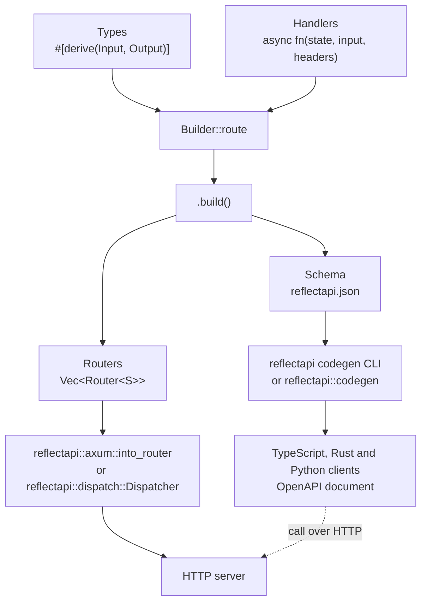

# How It Works

reflectapi treats an API as a set of named calls. Each call has:

- a **name**, such as `users.get`;
- an **input**: the request body;
- an **output**: the response body;
- an **error**: the response body when the call fails, sent with an HTTP
  status the error chooses;
- **headers**: the request headers the call reads.

Everything else follows from these five. The URL path is the name, the method is
`POST`, and the status says whether the body is the output or the error
([On the Wire](./wire.md) has the details). A generated client needs no more
than that, so each route becomes a typed function: `client.users.get(input,
headers)`, returning the output or the error.

## The flow



One definition produces both sides: the schema, from which the clients are
generated, and the routers that serve the routes. Both come from the same Rust
types and handlers, so a client generated from the current schema matches the
server.

## Types

A type the server reads (a request body or request headers) derives
[`Input`](https://docs.rs/reflectapi/latest/reflectapi/trait.Input.html)
next to serde's `Deserialize`. A type it writes (a response, an error, a
stream item or response headers) derives
[`Output`](https://docs.rs/reflectapi/latest/reflectapi/trait.Output.html)
next to `Serialize`. A type used both ways derives all four.

The derives read serde's attributes (`rename`, `tag`, `flatten`, `default`,
`skip_serializing_if` and the rest), so the schema describes what serde
actually reads and writes. Doc comments on types, fields and variants are
carried into the generated clients.

A type is reflected separately as input and as output, because serde can
treat the two directions differently. A field with `#[serde(default)]` is
optional in a request; a field with `#[serde(skip_serializing_if = "...")]`
may be missing from a response. The [Attributes](../getting-started/attributes.md)
reference lists what reflectapi adds on top of serde.

Primitives, `String`, `Option`, `Vec`, maps, tuples and many library types
(`chrono`, `uuid`, `url` and others, behind crate features) already implement
both traits. [`reflectapi::Empty`](https://docs.rs/reflectapi/latest/reflectapi/struct.Empty.html) stands for "nothing": no input, no headers or
no output. [Types](./types.md) covers what can cross the API and how to bring
in a type reflectapi doesn't know.

## Handlers

A handler is an async function of three arguments:

```rust
# type S = ();
# type I = reflectapi::Empty;
# type H = reflectapi::Empty;
# type R = reflectapi::Empty;
async fn handler(state: S, input: I, headers: H) -> R
# { reflectapi::Empty {} }
```

- `state` is the application state, cloned into every call. Make it cheap to
  clone, such as an `Arc`.
- `input` is the deserialized request body.
- `headers` is a struct whose fields are the request headers the route reads,
  named by their serde names, in lowercase. Use `reflectapi::Empty` for none. See
  [Request Headers](../clients/index.md#request-headers).
- `R` is either the output, for a route that cannot fail, or
  `Result<Output, Error>`. These are the two forms
  [`IntoResult`](https://docs.rs/reflectapi/latest/reflectapi/trait.IntoResult.html)
  accepts. The error type implements
  [`StatusCode`](https://docs.rs/reflectapi/latest/reflectapi/trait.StatusCode.html),
  which gives the HTTP status of its response. See [Errors](./errors.md).

The handler must be `Copy`, `Send` and `Sync`, and its future `Send`: an `async
fn` item works, as does a closure that captures nothing. Anything else it needs
comes in through `state`.

A stream route's handler has the same arguments and returns
`Result<impl Stream<Item = T>, Error>`. It is registered with
[`Builder::stream_route`](https://docs.rs/reflectapi/latest/reflectapi/struct.Builder.html#method.stream_route) and served as Server-Sent Events
([Streaming Endpoints](../clients/index.md#streaming-endpoints)).

## The builder

[`Builder`](https://docs.rs/reflectapi/latest/reflectapi/struct.Builder.html)
collects the routes. Each `route` call takes a handler and a function that
configures it through a
[`RouteBuilder`](https://docs.rs/reflectapi/latest/reflectapi/struct.RouteBuilder.html):
its name, description, whether it is readonly, its tags and its deprecation.
The configuration function is a plain `fn`, so its closure cannot capture
variables.

```rust
use reflectapi::{Builder, Empty, Input, Output};
use serde::{Deserialize, Serialize};

/// A user of the system.
#[derive(Serialize, Output)]
struct User {
    id: u32,
    name: String,
}

#[derive(Deserialize, Input)]
struct GetUserRequest {
    id: u32,
}

#[derive(Serialize, Output, reflectapi::StatusCode)]
enum GetUserError {
    /// No user has this id.
    #[reflectapi(status = 404)]
    NotFound,
}

#[derive(Deserialize, Input)]
struct AuthHeaders {
    authorization: String,
}

async fn get_user(
    _state: (),
    request: GetUserRequest,
    _headers: AuthHeaders,
) -> Result<User, GetUserError> {
    match request.id {
        1 => Ok(User { id: 1, name: "Alice".into() }),
        _ => Err(GetUserError::NotFound),
    }
}

async fn health_check(_state: (), _input: Empty, _headers: Empty) -> Empty {
    Empty {}
}

let (schema, routers) = Builder::new()
    .name("Users")
    .route(get_user, |b| {
        b.name("users.get")
            .description("Get a user by id")
            .readonly(true)
    })
    .route(health_check, |b| b.name("health.check"))
    .build()
    .expect("a valid API");

let names: Vec<&str> = schema.functions().map(|f| f.name()).collect();
assert_eq!(names, ["users.get", "health.check"]);

let get = schema.functions().next().unwrap();
assert!(get.readonly());
assert!(get.error_type.is_some());
assert!(get.input_headers().is_some());

// A route that can't fail has no error type, and `Empty` is no input.
let health = schema.functions().nth(1).unwrap();
assert!(health.error_type.is_none());
assert!(health.input_type().is_none());

// One router per builder; `extend` and `nest` add more.
assert_eq!(routers.len(), 1);
```

[`build()`](https://docs.rs/reflectapi/latest/reflectapi/struct.Builder.html#method.build) checks the definition and returns the schema and the routers, or
every problem it found as
[`BuildErrors`](https://docs.rs/reflectapi/latest/reflectapi/struct.BuildErrors.html).
A server that doesn't need the schema at runtime can build the routers alone;
see [build modes](../serving/other-servers.md#build-modes).

A readonly route is served on `GET` as well as `POST`. The schema records the
flag, but the generated clients call every route with `POST`.

A larger API is split across several builders, combined with [`Builder::nest`](https://docs.rs/reflectapi/latest/reflectapi/struct.Builder.html#method.nest)
and [`Builder::extend`](https://docs.rs/reflectapi/latest/reflectapi/struct.Builder.html#method.extend), and can sit under a base path set with [`Builder::path`](https://docs.rs/reflectapi/latest/reflectapi/struct.Builder.html#method.path).
See [Organising a Larger API](./organising.md).

## Names become namespaces

The route name is both the URL path and the client function. Dots split it
into namespaces: `users.get` is `client.users.get(...)` in TypeScript, Python
and Rust, and `admin.users.get` nests one level deeper. A `-` in a name becomes
`_` in the clients, so `pets.get-first` is `client.pets.get_first(...)`.

## The schema

The schema is the API without the code: the routes, with their names,
descriptions and flags, and every type they use. It serializes to JSON, and is
usually written to a `reflectapi.json` file:

```rust,no_run
# fn main() -> Result<(), Box<dyn std::error::Error>> {
# let (schema, _) = reflectapi::Builder::<()>::new().build()?;
std::fs::write("reflectapi.json", serde_json::to_string_pretty(&schema)?)?;
# Ok(())
# }
```

The `reflectapi` CLI generates clients from that file:

```bash
reflectapi codegen --language typescript --schema reflectapi.json --output clients/typescript/
```

The same generators are available in Rust as [`reflectapi::codegen`](https://docs.rs/reflectapi/latest/reflectapi/codegen/index.html), behind
the `codegen` feature, for generating clients from a build step or a test
without the CLI
([example](../serving/workers.md#generate-the-schema-and-clients-at-build-time)).
[Generated Clients](../clients/index.md) describes each language's output, and
[Keep the client in sync](../guides/typescript-client-axum.md#keep-the-client-in-sync)
how to check the generated files in CI.

## Serving

The routers are framework-independent. An adapter puts them on an HTTP server:

- [axum](../serving/axum.md): [`reflectapi::axum::into_router`](https://docs.rs/reflectapi/latest/reflectapi/axum/fn.into_router.html) turns them into
  an `axum::Router`.
- [Cloudflare Workers and celld](../serving/workers.md): a small adapter
  over the dispatcher.
- [Any other server](../serving/other-servers.md):
  [`reflectapi::dispatch::Dispatcher`](https://docs.rs/reflectapi/latest/reflectapi/dispatch/struct.Dispatcher.html) routes a request to its handler and
  returns the response to send.

All of them serve the same [wire format](./wire.md).
