# Reflect Your Rust API into the World

A talk by Andrey Konstantinov at [Rust Forge 2025](https://rustforgeconf.com)
in Wellington: why reflectapi exists, why client generation through OpenAPI
kept failing, and a live demo of a server change turning into a compile error
in its client.

[Watch the recording on YouTube](https://www.youtube.com/watch?v=6Scgq9fBZQM&t=21675s).
What follows is the talk's script, lightly edited; the recording differs in
places.

## Introducing Rust at a start-up

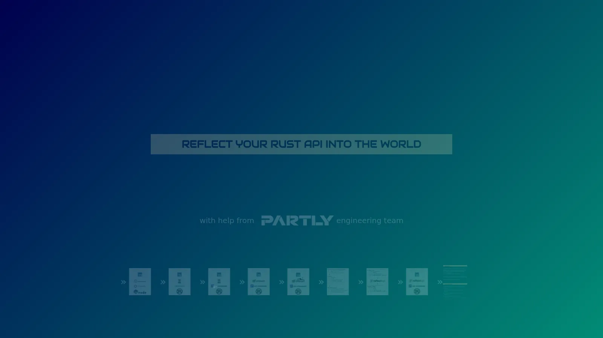

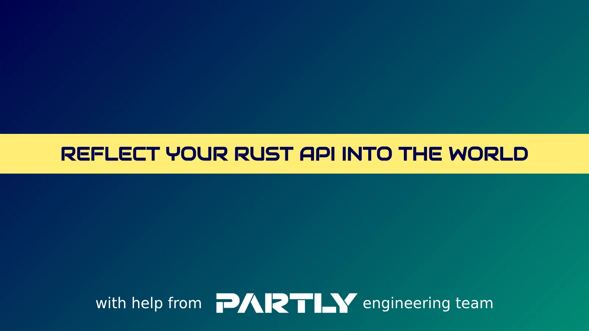

Hello, everyone, and thank you for the introduction!

I'm Andrey Konstantinov, System Architect at Partly, and it's a real pleasure
to be here at Rust Forge among so many passionate Rustaceans.

Today, I'd like to share our story at Partly: what it was really like to
introduce Rust at the fastest growing start-up here in New Zealand, some of
the challenges we faced, and what made it all worthwhile. On the technology
side, I'll focus on one of the biggest challenges we encountered: bridging
**efficiently** web services written in Rust with external systems, like web
apps written in TypeScript, and other services not necessarily using Rust.
While this problem isn't unique to the Rust ecosystem, we solved it with Rust
and ultimately created tools that are now available for everyone to use.

Let's get started.

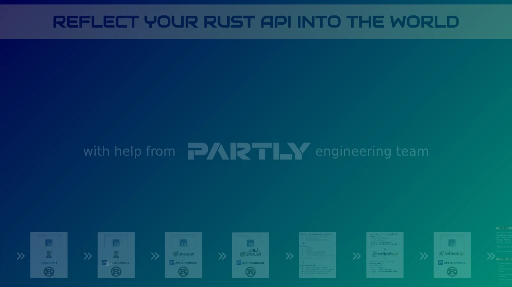

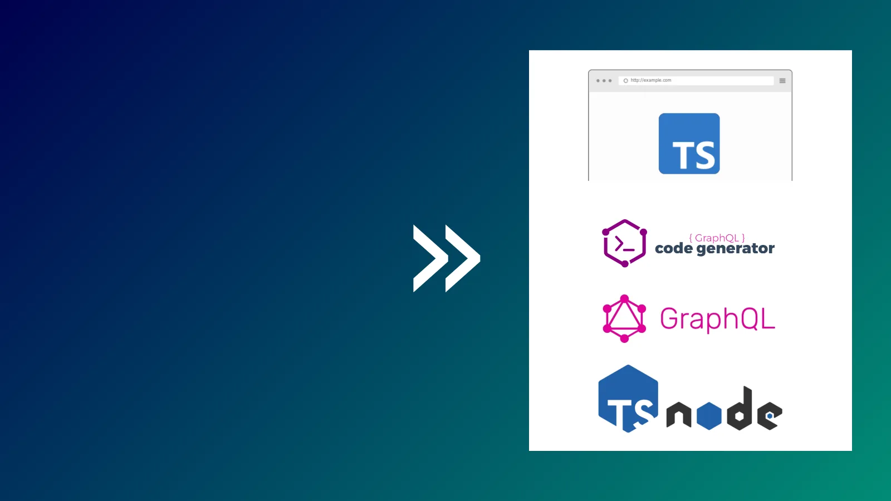

We started with a very typical stack for start-ups: one programming language
for the backend and for the frontend, a GraphQL based API, and an
automatically generated client for the backend API. In about a year and a
half, we faced performance problems related to data denormalisation, and to
the scalability of query throughput and latency. We evaluated and tried a
number of approaches to solve these problems, and finally kept two. We
continued scaling and optimising the JavaScript based approach for about a
year more, while I was working on an alternative stack in Rust, which aimed
to replace the existing solution.

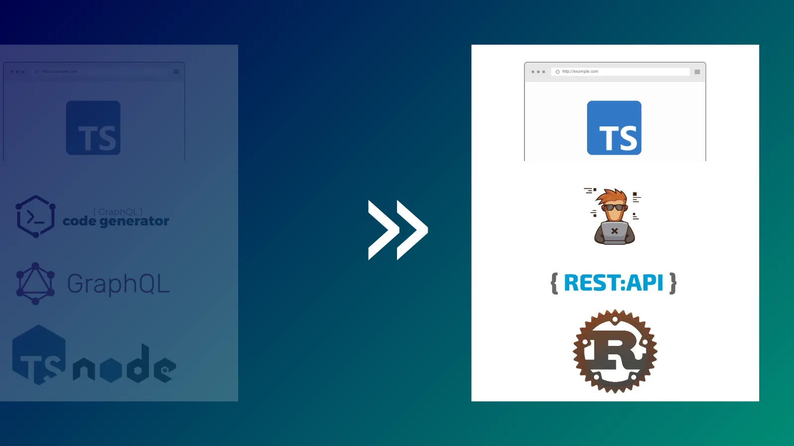

Let's focus on this moment a bit. We did not need Rust specifically as an
ultimate tool for optimising vertical CPU usage, although that was also a
problem we needed to address. The main driving factor for the language change
was the need to keep about 20 GB of shared, very frequently accessed global
data in memory, very close to the business logic, and to use it from more
than one thread.

I remember the day I announced, "I'm going to use Rust for the new stack."
Leading up to this, I had regularly shared news about Rust in Slack, things
like its ranking as the most loved language in the Stack Overflow survey, its
adoption by Amazon and Microsoft, and the establishment of the Rust
Foundation, so there was already some buzz around it within the company.

The initial reaction from three other developers was: "Hold on. We're
introducing a second major language; let's discuss which one it should be." I
replied, "Of course. What do you suggest?" About 30 minutes later, they came
back and said, "We think we should use Rust."

Of course, we had a brief discussion evaluating the pros and cons, and
considered other languages, but each was ruled out for specific reasons.
Ultimately, the team was enthusiastic and eager to be part of this journey,
excited by the challenge and the opportunity to learn a great programming
language.

We had three main concerns with Rust:

- a steep learning curve for everyone
- not being able to prototype as fast as the team could in TypeScript
- and not being able to hire more people easily

So, how did we address these concerns?

We assumed that if an engineer can't learn Rust in two weeks, they are not a
good enough hire for Partly. That assumption proved valid over time, and we
had no issues learning Rust. New people with, let's say, a Java background
continued to write Java-like code in Rust, but with gradual peer pressure, and
more hires with solid Rust knowledge, we managed to learn to write Rusty Rust.
There is always room for improvement, of course.

Prototyping and developing code fast also became possible once Rust knowledge
had spread. It took about a year, or a bit longer, until we started preferring
Rust even for prototypes and critical fast-paced development.

We had significant interest from software engineers in our company, not only,
but also, because we use Rust. Many came to us and said: "I applied to Partly
because you use Rust and aren't in the blockchain space." Some of the best
engineers we hired had prior C++ and systems experience, and were very much
interested and happy to transfer it to Rust.

So, our concerns evaporated, and we see using Rust as something of a
competitive advantage.

## From GraphQL to an API over HTTP

You may notice that we also started transitioning from GraphQL to a pure REST
API, or, as I'd put it, just an API over HTTP.

GraphQL was not a great fit for our problem domain, or for the size and
complexity of the data, and its performance was poor. Moving to the
alternative approach, we've been able to design each API endpoint around a
specific use case, which has made development and operations both more
reliable and more efficient on the server side, in time and cost.

## An API design standard

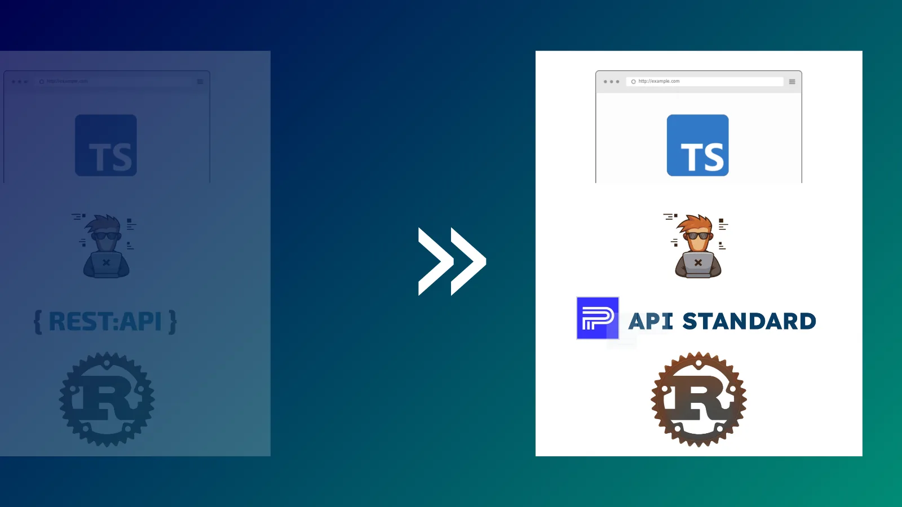

About a year after we decided to transition, we started developing a number
of new products, apps and services on this new architecture. We quickly
realised that we needed consistency in how we approached APIs over HTTP. Since
HTTP offers so many different ways to implement API calls and pass data, there
was a risk of massive inconsistency. To address this, we put time into
developing our own API design standard.

This standard is very opinionated. It cuts down on almost all of HTTP's
features. Every rule in the standard is justified by the goal of making API
endpoints as easy as possible to define, understand and implement, using only
one way. At the end of the day, an API call needs a name, an input type, and
an output type, including error cases. That's it.

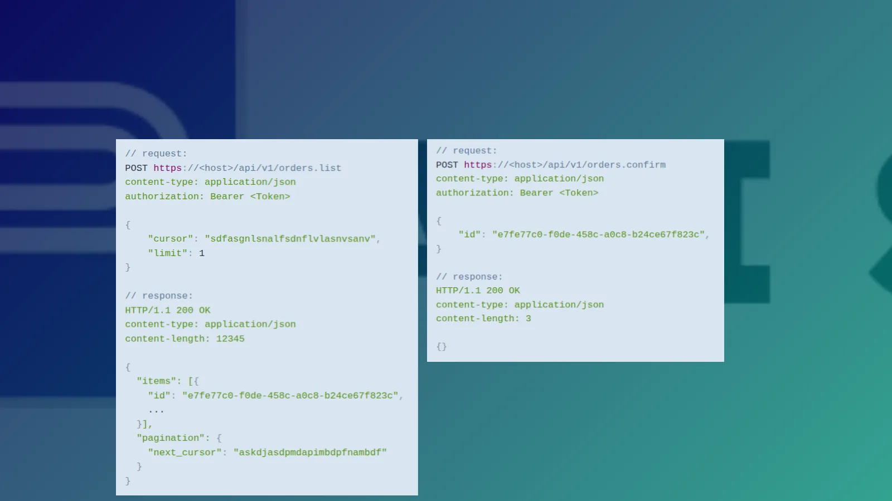

In our standard, the method name and the target collection are included in
the URL path. Input and output data are always in the body, and are always
defined as objects, even if empty. The response code for success is always
200; for errors, it's always in the 400s, but clients do not use the status
code. The HTTP method is always POST. There are many other rules for
structuring data and naming things, and we have open-sourced the standard:
it is [Partly's HTTP API Guidelines](./design/guidelines.md) in this guide.

If you're still debating how to structure API endpoints over HTTP, or facing
inconsistency between teams or apps, use our standard and save yourself a lot
of time. If you disagree with some of our choices, feel free to take it as a
starting point and adapt it to fit your own preferences.

## Why OpenAPI wasn't enough

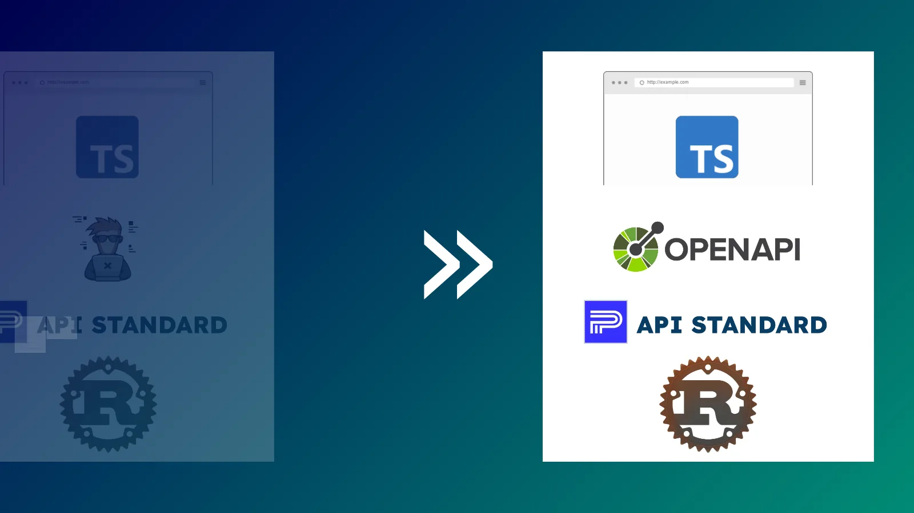

It was all going well, except for the manual effort of maintaining API clients
for TypeScript web apps; later, the same problem came up for services in Rust.
Manually written clients can deliver the intent and simplicity of the original
API layer from the server. I did it before Partly, and it worked well. But
Partly was moving fast, way too fast: massive type changes, new API endpoints
every day. Maintaining clients manually became a very significant effort, and
they were very frequently wrong: type mismatches between a client library and
the server API were all over the place. These clients, and so the apps using
them, could not be trusted to be verified at compile time.

The reality is that OpenAPI was the only choice in open source to describe
APIs over HTTP, in many if not all programming languages. The code generation
tooling evolved around it. Because it is so big and so widespread, you take it
for granted that it is verified, complete, the best choice.

Who is familiar with OpenAPI, or has used it before? Who has generated a
client from an OpenAPI schema?

So we applied OpenAPI.

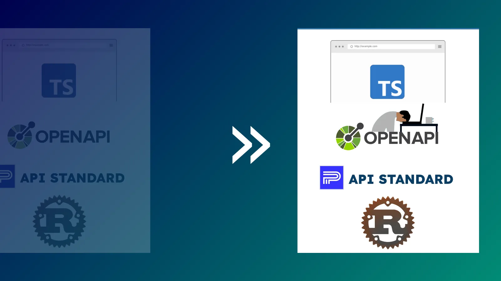

It started out promising. And every issue or limitation we faced was perceived
as minor and acceptable, something we could work around.

Here I refer to problems with OpenAPI and the corresponding codegen tools
combined, of which we tried three or four in total. Here are some of the
problems we faced over one to two years.

Limitations:

- a global namespace: you are forced to have global names, across all of
  your crates, for every type the API exposes
- no generics support: here is a real type name from our past code base,
  generated by the OpenAPI codegen. Quite short and very clear, isn't it?
- no named structured variants
- no structured error handling like in Rust
- no enum variants with structured data, no opaque "any" type, no partial
  structs

Bad developer experience, on both the client and the server side:

- duplicated route code for the schema
- hidden, implicit overrides of serde attributes by schemars
- no support for custom types
- unnecessary annotations, like an operation ID

More importantly, there was the loss of the clear, easy-to-understand intent
behind each API endpoint: that same easy name, input type and output type we
aimed for.

But the worst thing was incompatible client code generated. And 100% trusted
compatibility is what we wanted to achieve.

We ended up with nasty workarounds, like:

- giving up on bits of our API standard
- using two different generated clients to call two different API endpoints
  of the same server
- scripting cherry-picked patches of the generated code, which started
  falling apart pretty quickly
- for some API endpoints, giving up and returning to manually written client
  code

The more widely a tool is known and used, the harder it is to believe you
would encounter issues like these. Perhaps the rich data structures Rust
supports pushed the boundaries here, and maybe the tooling for other languages
works better; I'm not sure. I thought that surely it can't be that difficult
to have a proper, complete, bug-free code generation tool. I tried to write
such a tool myself, then I studied what other tools were doing, and why each
of them fell over in some places.

My conclusion was: building solid OpenAPI code generation tools is extremely
difficult, and in the general case, not really possible. There were three
major reasons:

- There is significant information loss from the original Rust types when
  translating to the OpenAPI specification. Rust's type system is very rich
  and expressive, but much of that nuance is lost in the conversion.
- Code generation tools are burdened with every possible feature and edge
  case of HTTP, even though, for our needs, we're only interested in three
  things: the name of a call, and its input and output type definitions.
- The data types in an OpenAPI schema aren't defined precisely; instead,
  they're constrained by "validators". So the true challenge for code
  generation tools is to infer the best matching type: not too restrictive
  (overfitting), but not too broad (underfitting) for the given constraints.
  Most tools attempt this by best-effort pattern matching, making educated
  guesses about what the original code's types were. This doesn't work
  reliably in the general case. For example, "is a number and is not a
  number" is valid OpenAPI input for codegen tools, and a comprehensive tool
  would need to handle all such cases.

All of this led me to conclude that OpenAPI is a poor architectural foundation
for robust client code generation for API services. This is a bold, and maybe
very opinionated, statement, but it's the honest summary of my experience.

## reflectapi

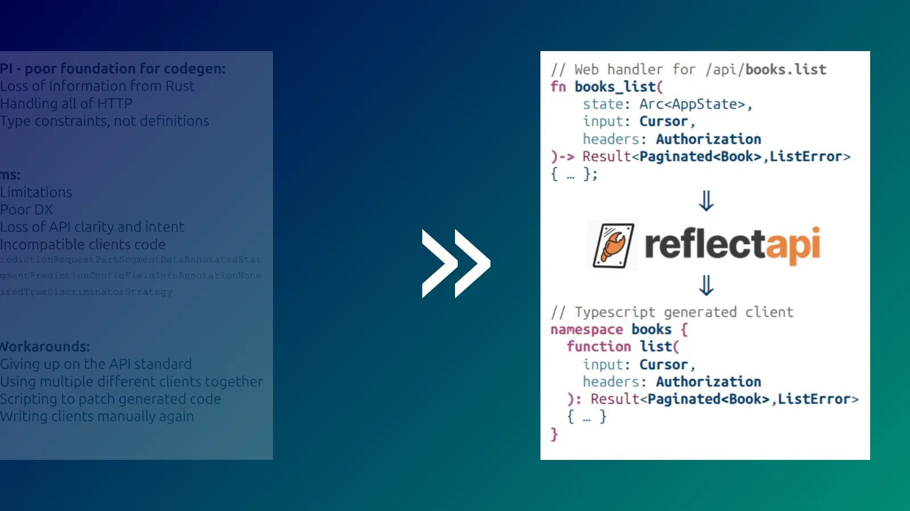

Assuming we're already working in Rust, with our web handler function
signatures defined and our types serializable and deserializable with serde,
could that alone serve as the single source of truth for client code
generation?

That's exactly what **reflectapi** does. It directly addresses the problem I
described. It uses Rust's derive macros to extract complete type information,
and presents it in a reflectapi-specific schema for code generation tools. It
supports all the features of Rust's type system, fully respects serde
attributes, and loses no type information, including generics, standard
library types and commonly used crates, and it makes adding support for any
third-party library or custom type straightforward.

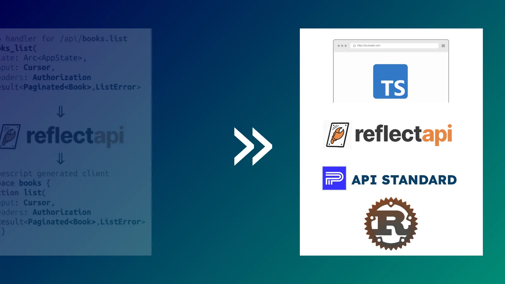

The tool replaced OpenAPI at Partly. I started working on reflectapi nearly
two years ago. Now it is maintained and extended by a few members of the
Partly team, and we have been using it in production for about a year.

I had a great developer experience with Rust's macro ecosystem, and it was a
fairly smooth ride. Macros and metaprogramming in Rust are well done, and
superior to other languages. However, I advise you not to use macros without
a very strong need: plain functions, traits and standard structures are always
preferable.

Let's have a look at reflectapi.

## Demo

Our goal is to turn a server-side function signature into the same
easy-to-use client-side function, with no, or very minimal, effort. Here is
the `books_list` function we saw earlier, with a fairly simple input type. Its
output type is a bit more complex: a generic, with a collection inside it,
holding all sorts of fields of various types, including enums with structured
data. There is a structured error response type. And there is an additional
type declaring what data to take from the request headers. Turning this
function into a reflected one is a matter of adding it to the route builder,
and making sure the types implement the `reflectapi::Input` and `Output`
traits. Notice that it is a reflectapi-specific router, agnostic of the actual
web server implementation.

With the builder done, we can turn it into an app. We use the plugin
reflectapi provides to integrate with axum, but other web server frameworks
are possible. We also have a bit of infrastructure to serve online docs with
the Redocly tool, from the same server, for convenience. The application saves
the reflectapi schema when run with the `--codegen` argument.

Once the server is up, we can look at the documentation. Since Redocly relies
on the OpenAPI spec, we do a minimal conversion from the reflectapi schema to
OpenAPI, solely for documentation. This spec is even less suitable for code
generation, as it has been adjusted specifically to render the docs well.

Client code generation is done with the reflectapi command line tool. It is
also possible to make the server write the generated client code directly.

And here is the generated client, and an example application using it: the
same signature intent, with the same input and output types. Generics are
rendered correctly, and required, optional and nullable fields are there.
Errors propagate all the way up to the client. An error here can be either a
network error or an application error. The first unwrap assumes it is an
application error and unfolds it. Then we match on the application error.
Notice that the result type and the match statement look just like what we
would write in Rust.

Let's change something. Let's pretend we have one more error case to return.
We add it on the server side, get a compiler error on the client side, fix it,
and we're good to go.

The official reflectapi GitHub repository has a more comprehensive example.

## Where next

Let's summarise: we, and now you, have a tool that gives API services written
in Rust precise, complete, extensible and automatically generated clients for
TypeScript, Rust and Python, delivering a great developer experience on both
the server and the client side.

Here's some feedback I've received from our team at Partly.

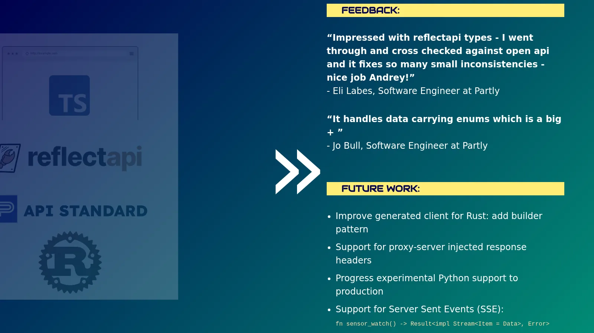

And here are some areas of potential future development for reflectapi.
Personally, I'm especially looking forward to adding support for server-sent
events.

> Since the talk, server-sent events have landed: a route can return a typed
> stream, and every client reads it as one. See [Streams](./concepts/wire.md#streams).

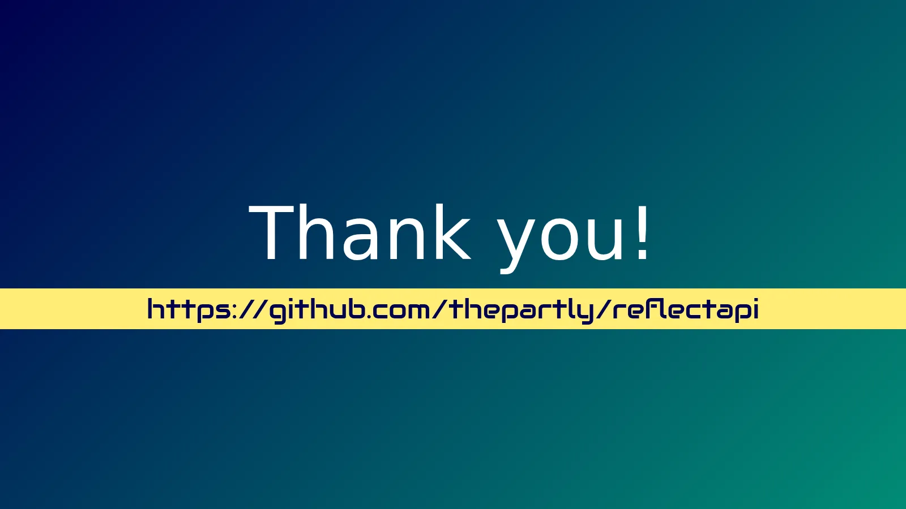

That's all. I hope you enjoyed it. If you have any questions about reflectapi,
Partly or me, please find me and let's have a chat.
